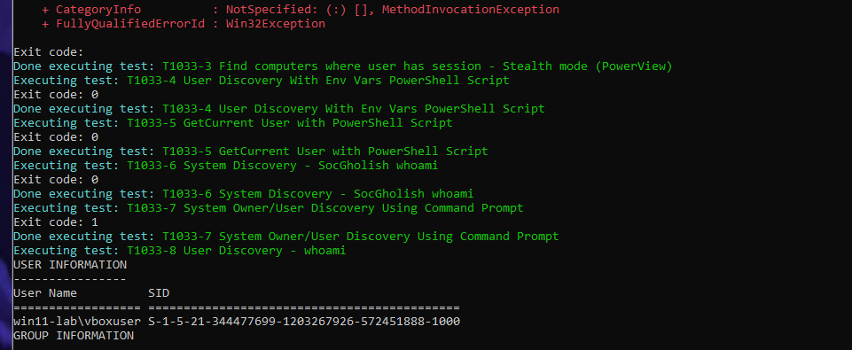
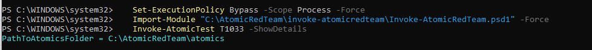
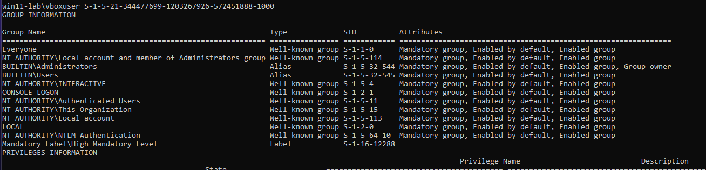
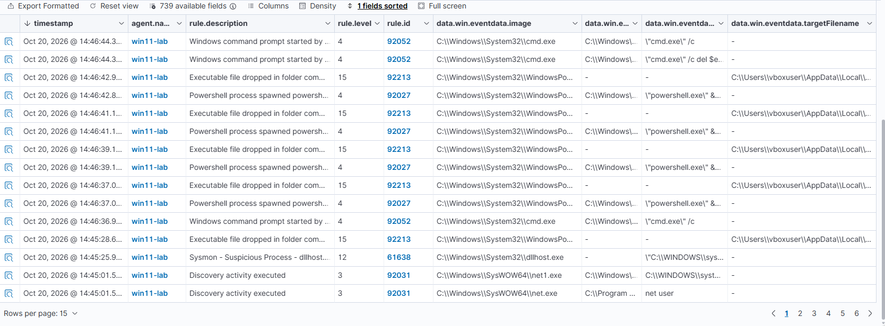
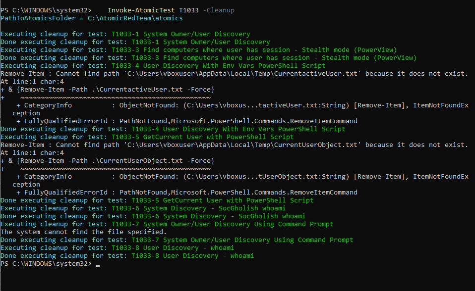

# Wazuh Lab Day 1 Write-Up

**System Owner/User Discovery (T1033) simulated with Atomic Red Team and observed in Wazuh**

## 1. Title and Date

- **Lab name:** System owner and user discovery attack
- **Date:** October 20, 2026
- **Time spent:** 1 hour
- **MITRE ATT&CK technique:** T1033 System Owner/User Discovery

## 2. Objective

Learn how a SIEM/XDR works, navigate Wazuh with confidence, and practice triaging alerts from a simulated attack, including separating expected test activity from unexpected alerts.

## 3. Environment

- **Host:** Oracle VirtualBox on an AMD Ryzen 5 3600. Resources allotted to the lab VM: 2 CPU cores, 60 GB disk, 8192 MB RAM (as recorded).
- **Windows VM (win11-lab):** Windows 11 Enterprise Evaluation; Sysmon, Wireshark, Atomic Red Team, and the Wazuh agent installed; IP 10.0.2.4.
- **Linux VM (Ubuntu-Lab):** Ubuntu Server 26.04.1 LTS running Wazuh 4.14.9 (indexer, server, and dashboard); IP 10.0.2.3.
- **Network:** Both VMs on one VirtualBox NAT Network, isolated from the home LAN.

## 4. Steps Performed

1. Allow scripts for this PowerShell session only:

   ```powershell
   Set-ExecutionPolicy Bypass -Scope Process -Force
   ```

2. Load the Atomic Red Team module:

   ```powershell
   Import-Module "C:\AtomicRedTeam\invoke-atomicredteam\Invoke-AtomicRedTeam.psd1" -Force
   ```

3. Read what the T1033 tests do before running them. This only prints test details and does not execute anything:

   ```powershell
   Invoke-AtomicTest T1033 -ShowDetails
   ```

4. Run the tests (tests 1 and 3 to 8 ran; T1033-3, a PowerView test, returned an error and T1033-7 exited with code 1):

   ```powershell
   Invoke-AtomicTest T1033
   ```

5. Run the cleanup commands that come with the tests:

   ```powershell
   Invoke-AtomicTest T1033 -Cleanup
   ```

6. Filtered the Wazuh Threat Hunting view to the run's time window and reviewed the alerts (section 5).

## 5. Expected vs. Actual Detection

| Test / Technique | Expected detection | What Wazuh showed | Rule ID and level | Detected? |
|---|---|---|---|---|
| T1033 discovery commands (*whoami /all*, *net user*) | Sysmon process-creation events for the commands, alerted as discovery activity | "Discovery activity executed" for net.exe and net1.exe (*net user*) | 92031, level 3 | **Partial.** Tagged by Wazuh as MITRE Account Discovery, not as T1033. |
| Atomic Red Team launching PowerShell and cmd.exe | Process-creation alerts for the PowerShell and cmd.exe children the test framework starts | "Powershell process spawned powershell instance"; "Windows command prompt started by an abnormal process" | 92027, level 4; 92052, level 4 | **Yes.** Expected activity caused by the test framework. |
| None expected | No alert expected | "Sysmon - Suspicious Process - dllhost.exe" | 61638, level 12 | **Unexpected.** Likely benign: the file is at `C:\Windows\System32\dllhost.exe` and the command line has the standard `/Processid:{GUID}` form. Parent process and signature not yet checked. |
| None expected | No alert expected | "Executable file dropped in folder commonly used by malware" (5 alerts). Written by powershell.exe to `C:\Users\vboxuser\AppData\Local\Temp\__PSScriptPolicyTest_hweh3nbc.ga4.ps1` | 92213, level 15 | **Unexpected (false positive).** The filename matches PowerShell's own script-policy test file, which it writes when it starts. Not yet verified against Sysmon file-create events. |
| -Cleanup | Cleanup commands run and test files removed | `cmd.exe /c del $env:temp\user_info_*.tmp` | 92052, level 4 | **Yes.** Expected cleanup activity. |

## 6. Evidence



*Figure 1. Atomic Red Team running the T1033 tests. T1033-3 returned an error and T1033-7 exited with code 1.*



*Figure 2. Session setup: execution policy, module import, and -ShowDetails (read-only).*



*Figure 3. Output of the discovery commands: the vboxuser account is in the local Administrators group and runs at High mandatory level.*



*Figure 4. Wazuh Threat Hunting events for win11-lab: rules 92031, 92027, 92052, 92213, and 61638 between 14:45 and 14:46.*

## 7. Analysis

The test ran system and user discovery commands, including *whoami /all* and *net user*. The output (Figure 3) shows that the account is an administrator with a High integrity level, which is the information an attacker looks for right after getting access. Discovery does not damage anything. It reads information so the attacker can decide what to do next, which is why defenders watch for it.

Wazuh recorded the activity as process events and mapped it to MITRE techniques such as Account Discovery and PowerShell/Command Shell, not to T1033 itself. The PowerShell and cmd.exe alerts were caused by the Atomic Red Team framework.

To tell this apart from normal administrator activity, an analyst would check the parent process, the command lines, and how fast several discovery commands ran together. Two alerts needed triage. The dllhost.exe alert (level 12) looked normal on a path and command-line check, and the level 15 file-drop alert pointed to a PowerShell script-policy test file in the Temp folder, which suggests framework noise. Neither is confirmed beyond that evidence.

## 8. Gaps and Improvements

**Gaps**

- **No T1033 label.** The test ran, but Wazuh tagged the activity as Account Discovery and PowerShell instead of T1033.
- **Noisy high-severity alerts.** Rule 92213 fired five times at level 15 and rule 61638 at level 12, while the PowerShell activity was level 4 and discovery was level 3. Severity does not match how much each event matters.
- **Rule naming.** The rule says "executable file" but the file in this case was a .ps1 script.
- **No test-versus-attack context.** Wazuh cannot tell Atomic Red Team activity from an intrusion, so the analyst needs process lineage and command lines.

**Next steps (not yet done)**

- Write a custom rule that matches *whoami* and *net user* in Sysmon process-creation events and tags them T1033.
- Tune rule 92213 for PowerShell's own script-policy test file pattern, carefully, so real dropped executables still alert.
- Correlate PowerShell with several discovery commands in a short window, since that pattern is more meaningful than one command.
- Verify the dllhost.exe parent process (expected svchost.exe) and the file signature.

## 9. Cleanup



*Figure 5. `Invoke-AtomicTest T1033 -Cleanup`. The two "path does not exist" errors are harmless: those temporary files were already gone.*

## 10. Lessons Learned

A high alert level does not mean an attack. The level 15 and level 12 alerts were explained by the test framework and by normal Windows behavior, and the evidence that decides it is in the fields (parent process, command line, file path, signature). Wazuh's MITRE tags come from its own rules, not from the test I ran, so a technique can run without being labeled. Next I will write one custom rule and re-run the test from a clean snapshot.
